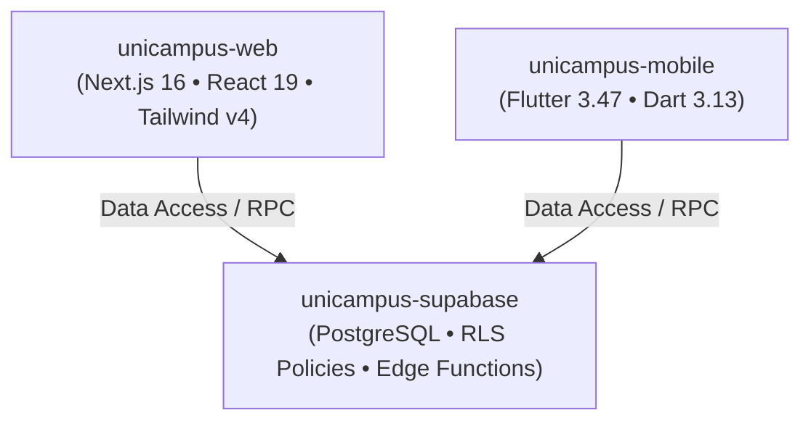
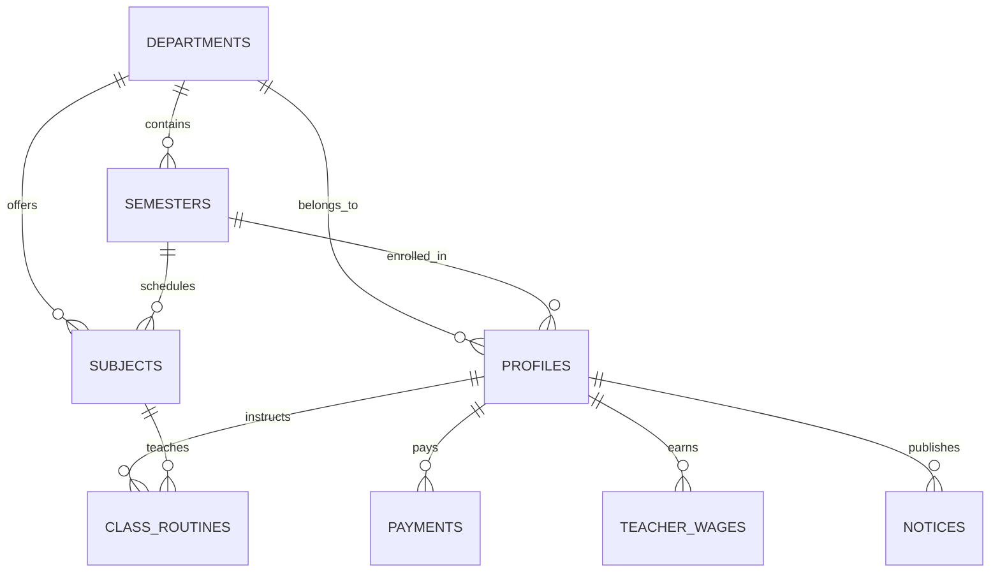

# UniCampus — Master Architecture & Canonical Project Memory

> **Status:** Monorepo Active • Web Portal Complete • Mobile Porting in Progress • Supabase Schema Live  
> **Master Router:** [`AGENTS.md`](file:///home/sakib360/sakib-codes/UniCampus/AGENTS.md) • **Task Tracker:** [`PROGRESS.md`](file:///home/sakib360/sakib-codes/UniCampus/PROGRESS.md) • **Bug Tracker:** [`BUGS_AND_DEBT.md`](file:///home/sakib360/sakib-codes/UniCampus/BUGS_AND_DEBT.md)

---

## 1. Monorepo Architecture Overview

UniCampus is architected as an integrated cross-platform campus management and student lifecycle platform:



- **[`unicampus-web`](file:///home/sakib360/sakib-codes/UniCampus/unicampus-web/)**: Web portal for Students, Faculty, and University Administrators. Built with Next.js 16 App Router, React 19, Tailwind CSS v4, and Framer Motion.
- **[`unicampus-mobile`](file:///home/sakib360/sakib-codes/UniCampus/unicampus-mobile/)**: Cross-platform mobile client for Android, iOS, Windows, and Linux. Built with Flutter 3.47 and Google Fonts Inter.
- **[`unicampus-supabase`](file:///home/sakib360/sakib-codes/UniCampus/unicampus-supabase/)**: Relational Postgres database, authentication, RLS security policies, and migration scripts.

---

## 2. Canonical Design Tokens & Design System

Both Web and Mobile clients strictly conform to these shared Calm Campus design tokens:

### Brand Color Palette
| Token Name | Hex Code | Semantic Role |
|---|---|---|
| **Brand Primary Indigo** | `#605BFF` | Primary action buttons, active states, progress arcs |
| **Brand Indigo Hover / Dark**| `#4F46E5` / `#7C78FF` | Focus rings, hover states, dark mode accent |
| **Light Canvas Base** | `#F5F5FA` | Web background, mobile light background base |
| **Light Card Surface** | `#FFFFFF` | Elevated cards, modals, navigation drawers |
| **Light Hairline Border** | `#E7E7F0` | Light mode card borders, hairline list dividers |
| **Dark Canvas Base** | `#0B0B10` | Web & mobile dark canvas background |
| **Dark Card Surface** | `#15151D` | Web & mobile dark elevated cards & panels |
| **Dark Border Default** | `#262630` | Dark mode dividers, borders, input outlines |
| **Success Emerald** | `#10B981` | Paid status, lecture in-progress, passing grades |
| **Warning Amber** | `#F59E0B` | Pending approvals, lab course indicator, alerts |
| **Danger Rose** | `#EF4444` | Rejected status, overdue balances, errors |

### Typography & Geometry
- **Font Family**: Google Fonts `Inter` (across both Web and Mobile). Minimum 12px anywhere; 15px standard body; 13px subtext.
- **Corner Radii**: Standard cards `rounded-[20px]`; modals `rounded-[24px]`; pills `rounded-full`.
- **Card Aesthetics**: Solid surfaces, 1px subtle border, zero glassmorphism, zero floating glow or ambient radial effects.
- **Touch Target Minimum**: 44px × 44px with 8px+ touch margins on all interactive controls.
- **Motion Easings**: Subtle `framer-motion` transitions with cubic-bezier `[0.16, 1, 0.3, 1]` with instant snap on completion. Zero dead Tailwind v4 classes.
- **Unified Portal Shell**: Single responsive `PortalShell` for Student, Teacher, and Admin portals featuring desktop `SideNav`, sticky `TopBar`, and mobile `BottomTabs`.

---

## 3. Database Schema Reference (`unicampus-supabase`)

Defined in [`unicampus-supabase/migrations/20261017_admin_portal_schema.sql`](file:///home/sakib360/sakib-codes/UniCampus/unicampus-supabase/migrations/20261017_admin_portal_schema.sql):



### Core Tables Summary
1. `departments`: ID, name, unique code, `head_teacher_id` (FK to profiles), faculty classification.
2. `semesters`: Strictly ordinal (`1st Semester` through `8th Semester`), order index (1–8), linked to department.
3. `profiles`: Extends `auth.users`, role enum (`student`, `teacher`, `admin`), student ID / teacher code, approval flag.
4. `user_roles`: Multi-role assignment support per user profile.
5. `subjects`: Department & semester curriculum courses, code, title, credits (e.g. 3.0), type (`Theory` or `Lab`).
6. `class_routines`: Weekly schedules, day of week (`Sunday`–`Thursday`), start/end time, room number, instructor.
7. `notices`: Campus announcements with target audience filter (`all`, `students`, `teachers`, `department`), pinned flag, attachments.
8. `payments`: Student tuition and fees ledger, transaction ID, receipt reference, status (`Paid`, `Pending`).
9. `teacher_wages`: Monthly faculty payroll, disbursement records, salary slips, status (`Disbursed`, `Pending`).

---

## 4. Platform Parity Status

For the granular task-by-task breakdown, see [`PROGRESS.md`](file:///home/sakib360/sakib-codes/UniCampus/PROGRESS.md).

```
Feature Area                   Web Status      Mobile Status     Backend Schema
--------------------------------------------------------------------------------
Splash & Brand Intro           Completed       Completed         N/A
Authentication & Onboarding    Completed       Completed         Supabase Auth
Student Dashboard              Completed       Pending Port      profiles, routines
Academic Audit & Degree Audit  Completed       Pending Port      subjects, semesters
Class Routine Matrix           Completed       Pending Port      class_routines
Campus Noticeboard             Completed       Pending Port      notices
Student Directory              Completed       Pending Port      profiles, departments
Faculty Directory              Completed       Pending Port      profiles, departments
Admin Executive Console        Completed       Web-Only          All tables
Teacher Attendance / Scanner   Completed       Pending Port      profiles, routines
Finance & Faculty Payroll      Completed       Web-Only          payments, teacher_wages
```

---

## 5. Responsive Engineering Guidelines (Web & Mobile)

- **Zero Horizontal Overflow**: Never place static containers wider than 320px without viewport-relative constraints (`w-[calc(100vw-2rem)]` or `max-w-md`).
- **Dual View Layout Pattern**:
  - Complex matrix views (like `/routine` and `/admin/users`) render as scrollable desktop data tables on screen width >= 1024px, and transform into vertical timeline / cards on mobile screen width < 1024px.
- **Copy Protection Policy**: Never apply `select-none` to student IDs, transaction hashes, roll numbers, or emails. Users must always be able to highlight and copy academic data.
