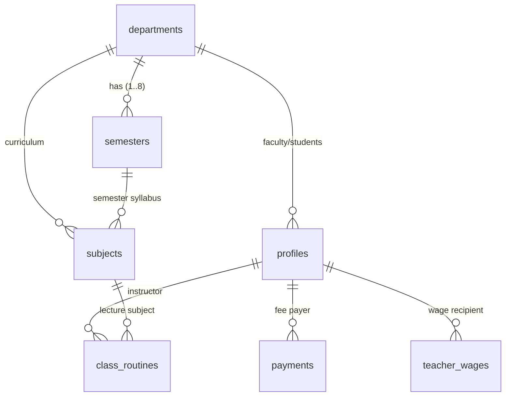

# UniCampus Supabase — Schema Map, Tables & RLS Policies

> **Database:** PostgreSQL on Supabase  
> **Directives:** [`AGENTS.md`](file:///home/sakib360/sakib-codes/UniCampus/unicampus-supabase/AGENTS.md) • **Master Router:** [`../AGENTS.md`](file:///home/sakib360/sakib-codes/UniCampus/AGENTS.md)  
> **Migration Source:** [`migrations/20261017_admin_portal_schema.sql`](file:///home/sakib360/sakib-codes/UniCampus/unicampus-supabase/migrations/20261017_admin_portal_schema.sql)

---

## 1. Relational Schema Map



---

## 2. Table Specifications

### 1. `public.departments`
- `id` (UUID, PK, `uuid_generate_v4()`)
- `name` (TEXT, NOT NULL) — e.g. "Computer Science & Engineering"
- `code` (TEXT, NOT NULL, UNIQUE) — e.g. "CSE"
- `head_teacher_id` (UUID, FK `profiles.id`, ON DELETE SET NULL)
- `faculty` (TEXT) — e.g. "Faculty of Science & Information Technology"
- `created_at` (TIMESTAMPTZ, DEFAULT `NOW()`)

### 2. `public.semesters`
- `id` (UUID, PK, `uuid_generate_v4()`)
- `department_id` (UUID, FK `departments.id`, ON DELETE CASCADE)
- `name` (TEXT, NOT NULL, CHECK in `'1st Semester'` through `'8th Semester'`)
- `order_index` (INT, 1–8, CHECK between 1 AND 8)
- **Constraint**: `UNIQUE(department_id, order_index)`

### 3. `public.profiles`
- `id` (UUID, PK, FK `auth.users.id`, ON DELETE CASCADE)
- `full_name` (TEXT, NOT NULL)
- `email` (TEXT, NOT NULL, UNIQUE)
- `role` (TEXT, NOT NULL, CHECK in `'student'`, `'teacher'`, `'admin'`)
- `department_id` (UUID, FK `departments.id`, ON DELETE SET NULL)
- `semester_id` (UUID, FK `semesters.id`, ON DELETE SET NULL)
- `teacher_code` (TEXT) — e.g. "T-CSE-104"
- `student_id` (TEXT) — e.g. "2023-1-60-042"
- `avatar_url` (TEXT)
- `is_approved` (BOOLEAN, DEFAULT FALSE)
- `created_at` (TIMESTAMPTZ, DEFAULT `NOW()`)

### 4. `public.user_roles`
- `id` (UUID, PK, `uuid_generate_v4()`)
- `user_id` (UUID, FK `profiles.id`, ON DELETE CASCADE)
- `role` (TEXT, NOT NULL)
- `is_primary` (BOOLEAN, DEFAULT FALSE)

### 5. `public.subjects`
- `id` (UUID, PK, `uuid_generate_v4()`)
- `department_id` (UUID, FK `departments.id`, ON DELETE CASCADE)
- `semester_id` (UUID, FK `semesters.id`, ON DELETE CASCADE)
- `code` (TEXT, NOT NULL) — e.g. "CSE-311"
- `title` (TEXT, NOT NULL) — e.g. "Database Management Systems"
- `credit` (NUMERIC(3,1), DEFAULT 3.0)
- `type` (TEXT, CHECK in `'Theory'`, `'Lab'`)
- **Constraint**: `UNIQUE(department_id, code)`

### 6. `public.class_routines`
- `id` (UUID, PK, `uuid_generate_v4()`)
- `subject_code` (TEXT, NOT NULL)
- `subject_title` (TEXT, NOT NULL)
- `day_of_week` (INT, CHECK 0–4: 0=Sun, 1=Mon, 2=Tue, 3=Wed, 4=Thu)
- `start_time` (TEXT, 'HH:mm')
- `end_time` (TEXT, 'HH:mm')
- `room` (TEXT, NOT NULL) — e.g. "Lab 402", "Room 601"
- `section` (TEXT, DEFAULT 'A')
- `teacher_name` (TEXT, NOT NULL)
- `teacher_id` (UUID, FK `profiles.id`, ON DELETE SET NULL)
- `department_name` (TEXT, NOT NULL)
- `semester_name` (TEXT, CHECK in `'1st Semester'` through `'8th Semester'`)

### 7. `public.notices`
- `id` (UUID, PK, `uuid_generate_v4()`)
- `title` (TEXT, NOT NULL)
- `body` (TEXT, NOT NULL)
- `category` (TEXT, DEFAULT 'Academics')
- `target_role` (TEXT, DEFAULT 'all', CHECK in `'all'`, `'student'`, `'teacher'`, `'admin'`)
- `department_id` (UUID, FK `departments.id`, ON DELETE SET NULL)
- `department_name` (TEXT, DEFAULT 'Campus Wide')
- `attachments` (JSONB, DEFAULT `'[]'`)
- `pinned` (BOOLEAN, DEFAULT FALSE)
- `author_name` (TEXT, DEFAULT 'University Registrar')
- `views` (INT, DEFAULT 0)

### 8. `public.payments`
- `id` (UUID, PK, `uuid_generate_v4()`)
- `transaction_id` (TEXT, UNIQUE, format `'TXN-YYYYMMDD-XXXX'`)
- `user_name` (TEXT, NOT NULL)
- `student_id` (TEXT)
- `user_id` (UUID, FK `profiles.id`, ON DELETE SET NULL)
- `department_name` (TEXT, NOT NULL)
- `semester_name` (TEXT, CHECK in `'1st Semester'` through `'8th Semester'`)
- `type` (TEXT, CHECK in `'student_fee'`, `'teacher_wage'`, `'late_fine'`)
- `amount` (NUMERIC(10,2), NOT NULL)
- `payment_method` (TEXT, CHECK in `'bKash'`, `'Nagad'`, `'Bank Transfer'`, `'Card'`)
- `status` (TEXT, DEFAULT 'Paid', CHECK in `'Paid'`, `'Pending'`, `'Overdue'`)
- `receipt_number` (TEXT, UNIQUE, format `'REC-XXXXXX'`)

### 9. `public.teacher_wages`
- `id` (UUID, PK, `uuid_generate_v4()`)
- `teacher_name` (TEXT, NOT NULL)
- `teacher_code` (TEXT, NOT NULL)
- `teacher_id` (UUID, FK `profiles.id`, ON DELETE SET NULL)
- `department_name` (TEXT, NOT NULL)
- `month` (TEXT, NOT NULL) — e.g. "October 2026"
- `base_amount` (NUMERIC(10,2), NOT NULL)
- `allowances` (NUMERIC(10,2), DEFAULT 0)
- `deductions` (NUMERIC(10,2), DEFAULT 0)
- `net_amount` (NUMERIC(10,2), NOT NULL)
- `status` (TEXT, DEFAULT 'Pending', CHECK in `'Disbursed'`, `'Pending'`)
- `payment_method` (TEXT, DEFAULT 'Bank Transfer')
- `disbursed_at` (TIMESTAMPTZ)
- `transaction_id` (TEXT, FK `payments.transaction_id`, ON DELETE SET NULL)

---

## 3. High-Performance Indices
```sql
CREATE INDEX idx_routines_schedule ON public.class_routines (day_of_week, start_time, end_time, room);
CREATE INDEX idx_routines_teacher ON public.class_routines (day_of_week, start_time, end_time, teacher_id);
CREATE INDEX idx_payments_status ON public.payments (status, type, department_name);
CREATE INDEX idx_wages_month_status ON public.teacher_wages (month, status);
```

---

## 4. Row Level Security (RLS) Rules
- **Admin Access**: Verified admins (`role = 'admin' AND is_approved = TRUE`) have full `ALL` CRUD access to all tables.
- **Authenticated Read Access**: Authenticated users have read (`SELECT`) access to public university resources: `notices`, `departments`, `semesters`, `subjects`, and `class_routines`.
- **Profiles Isolation**: Users can read and update only their own profile unless granted admin role.
